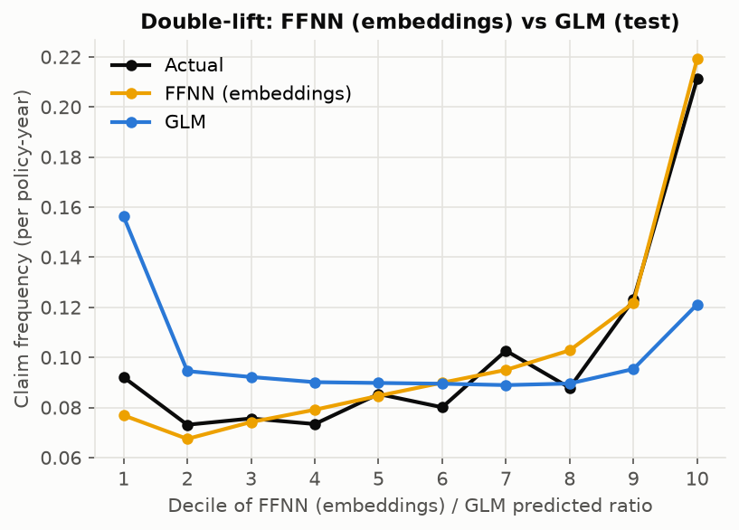
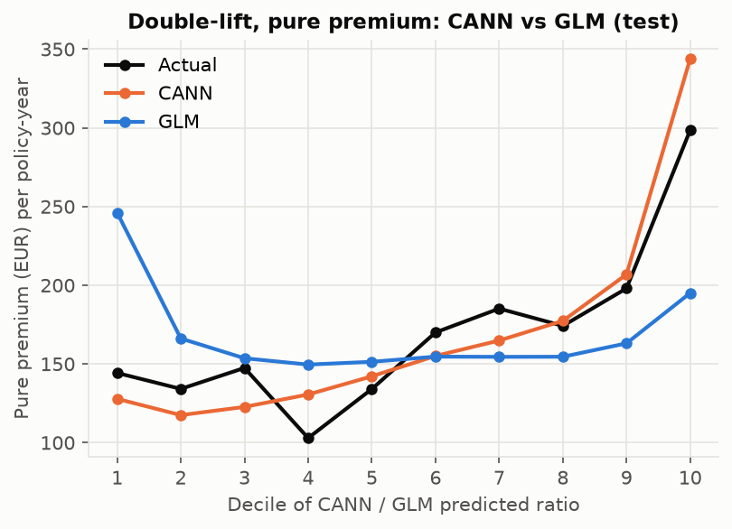
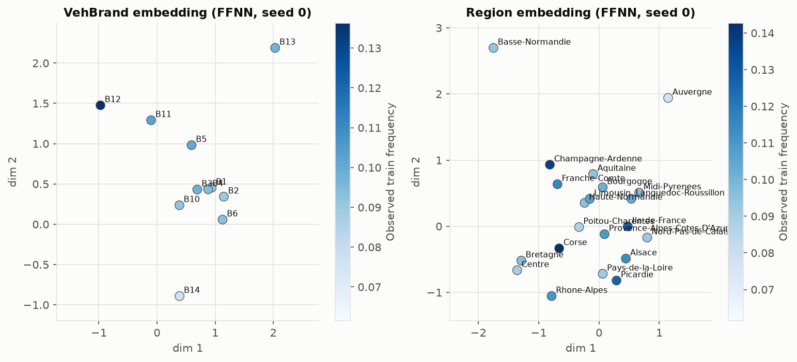
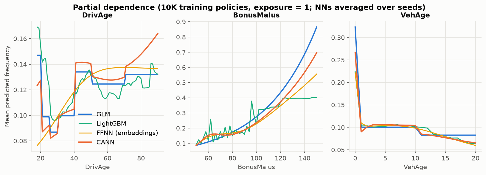
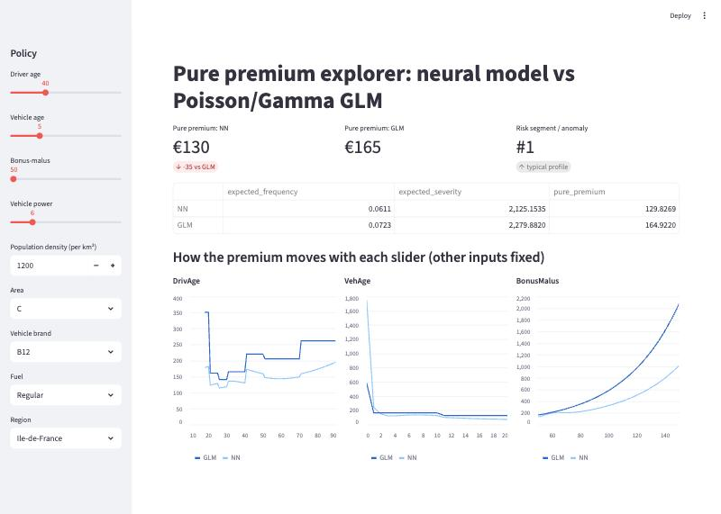

# Neural claim pricing vs the Poisson GLM on freMTPL2 (678K French motor policies)

**Key findings** (678K policies; test numbers on a duplicate-free split):

- **Duplicate policies inflate every flexible model's gain over the GLM.** The same insured appears under several policy IDs, and 33% of random-split test policies have an exact twin in train. Splitting so twins never straddle train and test shrinks LightGBM's gain by about a third (+4.3% → +3.2%) and the neural nets' by about 15% (+2.2% → +1.9%).
- **Where CANN and the GLM disagree, observed claims follow the network.** In the deciles where they disagree most, the GLM misprices claim frequency by 42–77% (chart below).
- **Short-exposure policies have 3.1× more claims than predicted**, a failure every model shares. Claims do not scale with exposure the way the industry-standard offset assumes.
- **Ranking on Poisson deviance: LightGBM > neural nets > GLM, every gap significant.** Against the GLM's 31.50 ×10⁻², tuned LightGBM scores 30.48 (−3.2%) and CANN 30.89 (−1.9%). Paired 95% CIs exclude zero for each gap, including LightGBM vs CANN.



*Double-lift on the test split: policies are sorted by the CANN/GLM prediction ratio. Where the two models disagree, observed claim frequency (black) follows the neural net. The GLM over-prices decile 1 by 77% and under-prices decile 10 by 42%. In the body: neural nets do not help on claim severity, and VAE segments separate risk worse than simple GLM-frequency bands.*

## How to run (3 commands)

```bash
make setup     # pip install -r requirements.txt
make all       # download → clean/split → train every config × seeds → evaluate on test → serving bundle → latency benchmark
make serve     # FastAPI on :8000   (make app → Streamlit premium explorer; make test → 19 tests)
```

Example: `curl -X POST 'localhost:8000/quote?model=nn' -H 'content-type: application/json' -d @serve/example_policy.json`

[](https://github.com/oladri-renuka/glm-vs-nets/actions/workflows/docker.yml): CI builds the serving image, prices a policy through the container, and checks that an unknown VehBrand gets a 422.

## The split matters: duplicate policies

freMTPL2 contains the same driver and car under several policy IDs. 38% of policies share every rating factor with at least one other policy. Under a plain random split, **32.8% of test policies have an exact twin in train**, so flexible models are partly scored on policies they have effectively already seen.

**All headline numbers therefore use `split_grouped`**: policies with identical rating factors always land in the same split. That leaves 0% twins across train and test. The split is stratified on "any claim in the group" and comes out 80.0/10.0/10.0, with matched claim rates (0.1005 train vs 0.1008 test). The plain random split is kept as a sensitivity check (I7, below).

## Results

All numbers are on the untouched test split (67,803 policies) unless marked "val". Deviance is the mean unit deviance ×10⁻² (lower is better). "± std" is across training seeds with a fixed data split. "Ensemble" averages the seed predictions. CIs are paired bootstraps over policies (1,000 resamples).

### Q1: Frequency (I1, I2), grouped split

| Model | Seeds | Test deviance (mean ± std) | Seed ensemble | Δ vs GLM | GLM − model, 95% CI | Σpred/Σactual |
|---|---|---|---|---|---|---|
| Homogeneous (one rate) | 1 | 33.195 | 33.195 | −5.38% | [−1.91, −1.48] | 0.997 |
| **Poisson GLM** (Noll et al. binning) | 1* | 31.499 | 31.499 | — | — | 0.999 |
| **LightGBM** (Poisson, offset, tuned) | 5 | **30.482 ± 0.005** | **30.477** | **+3.24%** | [0.85, 1.18] | 1.002 |
| FFNN, one-hot categoricals | 5 | 30.981 ± 0.023 | 30.919 | +1.84% | [0.43, 0.72] | 1.016 |
| FFNN, entity embeddings | 5 | 30.972 ± 0.030 | 30.912 | +1.86% | [0.43, 0.73] | 1.003 |
| CANN (GLM skip connection) | 5 | 30.981 ± 0.037 | 30.893 | +1.92% | [0.47, 0.74] | 1.008 |

\*The GLM (IRLS) and the homogeneous model are deterministic, so their seed std is 0 by construction.

- **Who wins:** gradient boosting, clearly. Every neural net trails LightGBM significantly (paired bootstrap): CANN is 0.42 ×10⁻² behind, 95% CI [0.31, 0.52] ([lgbm_vs_nn.md](reports/tables/lgbm_vs_nn.md)).
- **Was LightGBM tuned fairly?** Yes: it got a **20-trial random search** on validation deviance ([search table](reports/tables/lgbm_search.md)), and the best configuration was refitted on 5 seeds. The search surface is flat: every trial landed between 30.83 and 30.88 val. So the result does not hinge on tuning, and the neural nets do not beat gradient boosting here.
- **Embeddings vs one-hot (I2):** they tie (30.912 vs 30.919, inside the seed noise). Embeddings help interpretability (I3) more than accuracy.
- **CANN vs FFNN:** CANN is best of the nets by a hair. It also starts exactly at the GLM, which a test verifies, so the network only learns the GLM's residual. That makes it the easiest model for a pricing team to sign off.
- **Seed ensembling:** averaging 5 seeds is worth 0.06–0.09 ×10⁻², two to three times the single-seed std.
- **Calibration:** totals match within 1.6% (balance property), and decile plots are in [calibration_deciles.png](reports/figures/calibration_deciles.png).

### I7: How much does the random split inflate the gains?

| Δ vs GLM (seed ensemble) | Random split (twins leak) | Grouped split (headline) |
|---|---|---|
| LightGBM | +4.30% | +3.24% |
| FFNN (embeddings) | +2.13% | +1.86% |
| CANN | +2.19% | +1.92% |

The leakage inflates every flexible model: LightGBM's gain by about a third, the neural nets' by about 15%. The ranking (LightGBM > NN > GLM) and the significance of every gain are unchanged. Full table: [frequency_results_random_split.md](reports/tables/frequency_results_random_split.md). The random-split runs use 3 seeds, and LightGBM reuses the grouped-split search result.

### I4: Severity (Gamma deviance on 2,614 test claims)

| Model | Seeds | Test Gamma deviance | Ensemble | GLM − model, 95% CI |
|---|---|---|---|---|
| Constant mean | 1 | 1.1240 | 1.1240 | [−0.041, 0.001] |
| **Gamma GLM** | 1 | **1.1037** | **1.1037** | — |
| Gamma NN | 5 | 1.1095 ± 0.0034 | 1.1069 | [−0.016, 0.010] |

The severity network is now properly trained. At lr 1e-3 its validation deviance peaked at epoch 1. At lr 1e-4 with patience 100, its best epochs are 187–543, and validation deviance improved from 1.233 to 1.106–1.112. Even so, **it does not beat the Gamma GLM on test**: the CI includes 0, and the point estimate slightly favours the GLM. With 21K training claims and rating factors that carry little severity signal, deep learning has nothing extra to find.

Claims are capped at the train 99.5th percentile (€36,549; 120 claims). The capped excess is added back as a flat large-loss load of ×1.38.

### Pure premium: ranking and double-lift

| Pure premium = frequency × severity | Gini (± bootstrap sd) | Gini − GLM pair | Paired 95% CI (1,000 resamples) |
|---|---|---|---|
| GLM × Gamma GLM | 0.295 ± 0.022 | — | — |
| FFNN × Gamma NN | 0.315 ± 0.023 | +0.020 | [−0.008, +0.047] |
| CANN × Gamma NN | 0.318 ± 0.022 | +0.023 | [+0.000, +0.046] |
| LightGBM × Gamma GLM | 0.332 ± 0.023 | +0.037 | [+0.016, +0.058] |

Each Gini has a bootstrap sd of about 0.022, the same size as the gaps between pairs, so separate CIs would overlap. The paired bootstrap resamples the same policies for every pair, which removes the shared noise:

- Only **LightGBM × Gamma GLM** ranks losses significantly better than the GLM pair.
- CANN's improvement is borderline: the lower bound of its CI is 0.00004.
- FFNN's improvement is not significant.
- LightGBM vs each neural pair is not significant either (CI vs CANN [−0.008, +0.036]).

On pure-premium ranking, then, only "LightGBM beats the GLM" is supported. The neural nets' clear advantage is in frequency deviance and in the double-lift below. Table: [gini_pure_premium.md](reports/tables/gini_pure_premium.md).

Ordered Lorenz curve: [lorenz_pure_premium.png](reports/figures/lorenz_pure_premium.png). Policies are ranked by premium per policy-year.



The pure-premium double-lift above is what an insurer prices on. Predictions are rescaled to the actual total so that only ranking differs. Across deciles, CANN × Gamma NN is off by €18.6 per policy-year on average, against €40.8 for the GLM pair. It over-shoots the top decile (€344 vs €299 actual) but never misses as badly as the GLM does at either end (€246 vs €144 in decile 1, €195 vs €299 in decile 10).

**Note on totals.** 27.9% of test claims have no amount in the severity table (see Data decisions below). On policies with complete severity data, predicted pure premium is therefore ×1.39–1.42 above observed losses. That is the expected gap if the missing amounts are missing at random (1/0.721 = 1.39), and it is why every double-lift series is rescaled.

### I3: Embeddings



- **VehBrand:** the embedding is meaningful. Across brand pairs, embedding distance tracks the gap in log claim frequency (Spearman 0.53 ± 0.10 over 5 seeds). The high-frequency B12 and the low-frequency B14 sit apart from the cluster of mainstream brands.
- **Region:** the embedding is mostly noise (Spearman 0.08 ± 0.06). Once Density and Area are in the model, region adds little.

### Interpretability: partial dependence (NN vs GLM)



- **BonusMalus:** the GLM's log-linear term over-extrapolates. At BonusMalus 150 it predicts 0.87 claims/year, against 0.70 for CANN, 0.56 for the FFNN and 0.40 for LightGBM.
- **DrivAge:** CANN keeps the GLM's bins and adds a smooth correction. Above age 70 that correction keeps rising (0.16 at 90), an extrapolation backed by little data. The plain FFNN is smooth everywhere and puts 18-year-olds at the *bottom* of the curve (0.08), against 0.15 for the GLM and 0.17 for LightGBM.
- **VehAge:** all models agree. New vehicles have a high rate, there is a step at 10 years, then a decline.

### Q2: Segmentation (I5). The VAE does not find better risk segments.

Clusterers are fitted on train and evaluated on test. VAE and raw-feature results are means over 3 seeds. The full k = 4..10 sweep and segment profiles are in [reports/segmentation_report.md](reports/segmentation_report.md).

| k = 6 | Max/min segment frequency | Deviance reduction vs one rate | Silhouette | Seed stability (ARI) |
|---|---|---|---|---|
| **GLM-predicted-frequency bands** | **4.68×** | **4.46%** | 0.46 | 1.00 (deterministic) |
| k-means on raw standardized features | 2.65× | 1.62% | 0.12 | 1.00 |
| VAE latent + k-means | 2.23× | 1.20% | 0.21 | 0.65 |
| VAE latent + GMM | 2.29× | 0.53% | 0.08 | 0.67 |

The answer is **no**, at every k from 4 to 10. The VAE (now trained to convergence) is unsupervised: it compresses whatever explains the most variance in the rating factors, which is not what explains claims. Its clusters are also only moderately stable across seeds (ARI ≈ 0.65). Supervised GLM bands spread risk roughly twice as much. The API still returns the VAE segment, which is useful for describing the portfolio but not for pricing.

### I6: Anomalies

The autoencoder's top 1% of test policies by reconstruction error are older drivers (median 53 vs 44) with high BonusMalus (79 vs 50) in denser areas. They are dominated by rare brands: B14 is 46× over-represented, B13 5.7×. Their observed claim frequency is **1.5× the rest** (0.154 vs 0.100). Agreement between the 3 autoencoder seeds on which policies are in that top 1% is low (Jaccard 0.26), so treat the flag as a soft "review manually" signal.

## Failure analysis: where the models fail

Full tables: [failure_actual_vs_expected.md](reports/tables/failure_actual_vs_expected.md), [failure_deviance_by_claimnb.md](reports/tables/failure_deviance_by_claimnb.md), [failure_worst_policies.md](reports/tables/failure_worst_policies.md).

1. **Short exposures (the largest failure, and shared by all models).** Policies with ≤ 0.1 years of exposure have **3.1× more claims than predicted** (A/E 3.13 for CANN, 3.30 for the GLM). Full-year policies have 18% fewer than predicted. Every model treats exposure as a proportional offset, but here claims do not scale with exposure: policies are likely cancelled or re-issued after a claim. Modelling exposure non-linearly is the obvious next step.
2. **Young drivers.** CANN over-predicts 18–20-year-olds by 30% (A/E 0.77, 54 claims) and under-predicts 26–30-year-olds (A/E 1.17). The GLM shows the same pattern, slightly milder (0.81 / 1.12).
3. **Multi-claim policies.** The 3.4K test policies with a claim produce 68% of CANN's deviance. For the 185 policies with 2+ claims, the mean prediction is 0.11 claims. The worst case is IDpol 5896: 2 claims in 0.003 years. These are unforecastable from rating factors.
4. **Severity.** No model ranks claim cost meaningfully better than the Gamma GLM.
5. **Missing severities.** 27.9% of test claims have no amount. Whether they are missing at random cannot be tested here.

## Deployment

The service is in `serve/`.

- **Endpoint:** FastAPI `POST /quote?model=nn|glm` returns:
  - expected frequency, expected claims, expected severity
  - pure premium, both annual and for the requested exposure
  - VAE risk segment, with that segment's observed frequency
  - autoencoder anomaly flag and score
- **Validation:** a Pydantic schema enforces types, observed ranges and known categories. An unknown VehBrand or Region gets a 422 that lists the allowed values. `GET /health` is also available.
- **Model choice:** the served neural model is the **CANN 5-seed ensemble with the Gamma NN**. CANN was chosen over the FFNN by **validation** deviance, not test.
- **Why not serve LightGBM, the most accurate model?** The API serves CANN because it is the GLM plus a frozen-start residual network. A pricing team can sign off on it the way they sign off on GLM relativities, and its departure from the approved GLM is one explicit correction term that can be inspected, capped or switched off. LightGBM's further 0.42 ×10⁻² of deviance would need a separate governance case.

| Latency, one request at a time, Apple M4 CPU, 1 thread, n = 1000 | p50 | p95 |
|---|---|---|
| HTTP end-to-end, NN (5 CANN + 5 Gamma NN + AE + VAE) | 9.2 ms | 9.8 ms |
| HTTP end-to-end, GLM | 7.1 ms | 7.7 ms |
| In-process, NN | 8.1 ms | 8.4 ms |

- **Model size:** 0.15 MB for the whole bundle: weights, GLM coefficients, preprocessing and segmenter.
- **Docker:** the CI-built image is 1.3 GB, almost all of it CPU PyTorch.
- **Latency work:** the first version took 39 ms at p50 because preprocessing built a pandas frame for every model on every request. Rewriting it in numpy gave bit-identical inputs and a 4× speed-up.

`make app` opens the Streamlit premium explorer. Sliders for driver age, vehicle age and bonus-malus show NN and GLM premiums side by side, with curves of how each slider moves the premium:



## Data decisions

Counts are from `data/processed/cleaning_report.json`.

- **Source:** the Hugging Face mirror [mabilton/fremtpl2](https://huggingface.co/datasets/mabilton/fremtpl2), both tables. OpenML 41214 repeatedly timed out. The mirror has **678,013 policies** (verified) and 26,639 claim rows, the same counts as OpenML.
- **Consistency rule:** `ClaimNb` is kept exactly as published, so no frequency rows are dropped and the GLM stays comparable with Noll, Salzmann & Wüthrich (2018). Severity rows are used only for policies whose number of rows equals their `ClaimNb`.
  - **9,117 policies don't match**; 9,116 of them have claims but no amounts (9,658 claims in total).
  - **196 severity rows are dropped**: 195 orphans whose 6 policies are missing from the frequency table, and 1 partial row. 26,443 claims are kept.
- **Caps:** as in the reference analysis: ClaimNb ≤ 4 (9 rows), Exposure ≤ 1 (1,224), VehAge ≤ 20 (8,322), DrivAge ≤ 90 (401), BonusMalus ≤ 150 (209). Density enters as log(Density).
- **Split:** `split_grouped` with seed 2018 (see above). Exposure always enters as an offset or multiplier, never as a feature: `init_score` for LightGBM, and the GLM skip connection for CANN.

## Test-set discipline

Every model and configuration was chosen on validation before the grouped test split was read. The test split was then evaluated three times; no model, hyper-parameter or selection changed between runs:

1. The original run.
2. A rerun that added the paired bootstrap of the Gini differences.
3. A rerun that added the paired LightGBM-vs-neural-net deviance test.

Every table and figure from the first run came out byte-identical in the later runs (checked with `git diff`). Only the new tables were added.

The earlier version of this project used the random split as its main split. Its test set was evaluated three times. The reruns fixed bugs in the evaluation code (a Lorenz curve that ranked by exposure-scaled premium instead of premium per year, and a clipped plot label). No model, hyper-parameter or selection changed between those runs. That random-split test set appears here only in the I7 sensitivity table.

## Reproducibility

- **Configs:** every run starts from a YAML file in `configs/`: 15 experiment configs, all inheriting from `base.yaml`.
- **Seeds:** fixed throughout. 5 seeds for every seeded headline model, 3 for the sensitivity runs, the VAE and the autoencoder.
- **Tracking:** params, per-epoch validation metrics and final metrics are logged to MLflow (`mlflow ui --backend-store-uri sqlite:///mlflow.db`, experiment `freMTPL2-pricing-v2`).
- **Training setup:**
  - Frequency nets: Adam, lr 1e-3, batch 5,000.
  - Severity net: lr 1e-4, batch 1,000, patience 100.
  - AE/VAE: lr 3e-3, patience 30, cap 2,000 epochs. Every run stopped early, at best epochs 251–1,740 (the old 200-epoch cap had cut them all off).
  - All nets use early stopping on validation deviance or loss.
- **Compute:** everything ran on a laptop CPU (Apple M4). The full pipeline takes about 1.5 hours, dominated by the AE/VAE. RunPod budget: **$0**, because the models are too small for a GPU to help. `make all` runs unchanged on a RunPod CPU or GPU pod.
- **Known macOS issue:** LightGBM and PyTorch ship separate `libomp` copies. Loading both in one process crashes multi-threaded torch. Training processes therefore load only one of them, and `src/eval.py` imports LightGBM first and runs torch single-threaded.

## Layout

```
configs/      one YAML per experiment (inherits base.yaml); *_random = I7 sensitivity on the random split
src/data/     load.py (download, consistency rule, caps, splits), features.py (GLM design, NN preprocessing), schema.py
src/models/   glm.py, gbm.py, nets.py (PyTorch modules), neural.py (training wrappers)
src/train.py  trains one config (train/val only; LightGBM random search)
src/eval.py   the only reader of the test split
src/segmentation.py (I5/I6)   src/export.py (serving bundle, model chosen on validation)
serve/        app.py (FastAPI), schemas.py, predictor.py, streamlit_app.py, benchmark.py, Dockerfile
notebooks/    01_eda.ipynb: analysis only, train split only
reports/      figures/, tables/, segmentation_report.md, results.json
tests/        data rules, grouped split, metrics vs sklearn, CANN-starts-at-GLM, exposure offset, save/load, API validation
.github/      CI: Docker build + /quote smoke test, unit tests
```

## Limitations

- **Fairness / regulation:** the data has no protected attributes, but **DrivAge** (age) and **Region** (a geographic proxy for income and ethnicity) can act as proxies. Insurance pricing is regulated; for example, the EU Test-Achats ruling bans gender-based premiums, and age and geography rating face scrutiny. A real deployment needs a proxy-discrimination review, and the young-driver and over-70 behaviour above deserves one.
- **Grouping is by exact rating factors.** Near-duplicates (for example the same insured one year older) can still straddle the split, so the grouped split is conservative but not perfect.
- **One portfolio, one period, one country.** There is no time-based split, so nothing is said about drift.
- **Missing severities.** The assumption that the 27.9% of claims without amounts are missing at random is untestable here.
- **Pure premium only.** There are no expense, profit or reinsurance loadings, and large losses are handled with a single flat load.
