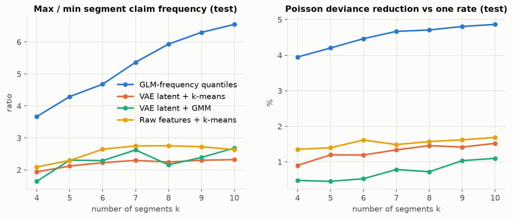

# Segmentation report (I5) and anomaly inspection (I6)

All numbers are measured on the held-out **test** split; clusterers were fitted on a
100K-policy sample of the training split. VAE/raw-feature metrics are means over 3 seeds.

## Method comparison at k = 6

| method       |   max_min_ratio |   max_min_std |   freq_cv |   deviance_reduction_pct |   silhouette |   ari |   min_exposure_share |
|:-------------|----------------:|--------------:|----------:|-------------------------:|-------------:|------:|---------------------:|
| glm_quantile |           4.679 |       nan     |     0.591 |                    4.464 |        0.463 | 1.000 |                0.110 |
| raw_kmeans   |           2.646 |         0.001 |     0.332 |                    1.617 |        0.121 | 0.998 |                0.094 |
| vae_gmm      |           2.290 |         0.052 |     0.189 |                    0.530 |        0.079 | 0.665 |                0.029 |
| vae_kmeans   |           2.227 |         0.137 |     0.287 |                    1.196 |        0.209 | 0.646 |                0.099 |

Full sweep over k = 4..10: [tables/segmentation.md](tables/segmentation.md).
`ari` is the mean pairwise adjusted Rand index across seeds (GLM quantiles are deterministic, so 1 by construction).
`deviance_reduction_pct` is the Poisson-deviance reduction from pricing each policy at its segment's observed rate.

## VAE k-means segments (k = 6, seed 0), sorted by observed frequency

|   segment |   policies |   exposure |   claims |   DrivAge |   BonusMalus |   VehAge |   VehPower |   Density |   diesel_share | top_area   | top_brand   | top_region                  |   exposure_share |   frequency |
|----------:|-----------:|-----------:|---------:|----------:|-------------:|---------:|-----------:|----------:|---------------:|:-----------|:------------|:----------------------------|-----------------:|------------:|
|         4 |      10580 |   7098.707 |      526 |    49.000 |       50.000 |   10.000 |      6.000 |   106.000 |          0.000 | C          | B1          | Centre                      |            0.197 |       0.074 |
|         5 |      14795 |   9114.325 |      733 |    46.000 |       50.000 |    7.000 |      6.000 |    88.000 |          0.932 | C          | B2          | Centre                      |            0.253 |       0.080 |
|         2 |      10932 |   5341.179 |      520 |    44.000 |       50.000 |    6.000 |      6.000 |  2558.000 |          0.898 | E          | B2          | Ile-de-France               |            0.148 |       0.097 |
|         0 |      11174 |   6182.622 |      618 |    48.000 |       50.000 |    7.000 |      6.000 |  3184.000 |          0.000 | E          | B1          | Ile-de-France               |            0.172 |       0.100 |
|         1 |      10830 |   4314.827 |      543 |    49.000 |       50.000 |    2.000 |      7.000 |   251.000 |          0.491 | C          | B12         | Provence-Alpes-Cotes-D'Azur |            0.120 |       0.126 |
|         3 |       9492 |   3939.950 |      687 |    28.000 |       90.000 |    8.000 |      6.000 |   579.000 |          0.471 | D          | B2          | Centre                      |            0.109 |       0.174 |

## GLM-frequency segments (k = 6) for comparison

|   segment |   policies |   exposure |   claims |   DrivAge |   BonusMalus |   VehAge |   VehPower |   Density |   diesel_share | top_area   | top_brand   | top_region    |   exposure_share |   frequency |
|----------:|-----------:|-----------:|---------:|----------:|-------------:|---------:|-----------:|----------:|---------------:|:-----------|:------------|:--------------|-----------------:|------------:|
|         0 |      11306 |   6942.607 |      385 |    39.000 |       50.000 |   11.000 |      6.000 |   118.000 |          0.533 | A          | B2          | Centre        |            0.193 |       0.055 |
|         1 |      11505 |   6899.185 |      470 |    47.000 |       50.000 |    8.000 |      6.000 |   214.000 |          0.517 | C          | B2          | Centre        |            0.192 |       0.068 |
|         2 |      11168 |   6497.514 |      513 |    49.000 |       50.000 |    6.000 |      6.000 |   303.000 |          0.520 | C          | B1          | Centre        |            0.181 |       0.079 |
|         3 |      11216 |   6228.328 |      556 |    48.000 |       50.000 |    5.000 |      6.000 |   528.000 |          0.472 | C          | B12         | Centre        |            0.173 |       0.089 |
|         4 |      11357 |   5481.634 |      680 |    41.000 |       72.000 |    6.000 |      6.000 |  1064.000 |          0.432 | E          | B12         | Centre        |            0.152 |       0.124 |
|         5 |      11251 |   3942.341 |     1023 |    41.000 |       80.000 |    0.000 |      6.000 |   824.000 |          0.482 | E          | B12         | Ile-de-France |            0.110 |       0.259 |

## Autoencoder anomalies: top 1% of test policies by reconstruction error

* Cut-off score 4.28; 0.98% of test policies exceed the training 99th-percentile threshold used by the API.
* Overlap of the top-1% sets across 3 autoencoder seeds (mean Jaccard): 0.26.
* Observed claim frequency: flagged 0.1537 vs rest 0.1003.

### Continuous features (medians)

|            |   rest_median |   top1pct_median |
|:-----------|--------------:|-----------------:|
| DrivAge    |        44.000 |           53.000 |
| VehAge     |         6.000 |            7.000 |
| VehPower   |         6.000 |            6.000 |
| BonusMalus |        50.000 |           79.000 |
| Density    |       392.000 |          706.500 |
| Exposure   |         0.490 |            0.450 |

### Over-represented categories among flagged policies (share and lift vs rest)

**VehBrand**

| VehBrand   |   False |   True |   lift |
|:-----------|--------:|-------:|-------:|
| B14        |   0.004 |  0.188 | 45.779 |
| B13        |   0.016 |  0.093 |  5.679 |
| B6         |   0.041 |  0.119 |  2.905 |
| B3         |   0.079 |  0.194 |  2.456 |

**Region**

| Region            |   False |   True |   lift |
|:------------------|--------:|-------:|-------:|
| Franche-Comte     |   0.002 |  0.010 |  5.441 |
| Corse             |   0.006 |  0.015 |  2.625 |
| Alsace            |   0.003 |  0.006 |  1.974 |
| Champagne-Ardenne |   0.004 |  0.007 |  1.690 |

**Area**

| Area   |   False |   True |   lift |
|:-------|--------:|-------:|-------:|
| F      |   0.028 |  0.082 |  2.903 |
| E      |   0.201 |  0.254 |  1.267 |
| D      |   0.223 |  0.206 |  0.923 |
| C      |   0.284 |  0.249 |  0.876 |

**VehGas**

| VehGas   |   False |   True |   lift |
|:---------|--------:|-------:|-------:|
| Regular  |   0.505 |  0.725 |  1.435 |
| Diesel   |   0.495 |  0.275 |  0.556 |

### Ten most unusual test policies

|      IDpol |   DrivAge |   VehAge |   VehPower |   BonusMalus | VehBrand   | VehGas   | Area   |   Density | Region             |   Exposure |   ClaimNb |   score |
|-----------:|----------:|---------:|-----------:|-------------:|:-----------|:---------|:-------|----------:|:-------------------|-----------:|----------:|--------:|
| 1077294.00 |        79 |       10 |          6 |          106 | B1         | Regular  | D      |      1466 | Nord-Pas-de-Calais |       1.00 |         1 |   21.89 |
| 3113589.00 |        25 |        3 |         15 |           76 | B6         | Regular  | C      |       107 | Rhone-Alpes        |       0.95 |         0 |   17.79 |
| 3075584.00 |        53 |       14 |         14 |           50 | B6         | Regular  | C      |       289 | Rhone-Alpes        |       0.27 |         0 |   17.40 |
| 3063254.00 |        84 |        2 |          6 |          112 | B10        | Diesel   | C      |       399 | Centre             |       0.04 |         0 |   16.89 |
| 4181976.00 |        19 |       12 |         15 |          100 | B3         | Regular  | C      |       302 | Alsace             |       0.48 |         0 |   16.85 |
| 4137800.00 |        33 |       15 |         14 |           50 | B6         | Regular  | B      |        81 | Centre             |       1.00 |         0 |   16.60 |
| 2119275.00 |        31 |       13 |         14 |           50 | B6         | Regular  | B      |        81 | Centre             |       1.00 |         0 |   15.89 |
| 3239150.00 |        35 |       11 |         14 |           51 | B6         | Regular  | C      |       223 | Midi-Pyrenees      |       0.08 |         0 |   15.73 |
| 3245868.00 |        35 |       11 |         14 |           51 | B6         | Regular  | C      |       223 | Midi-Pyrenees      |       0.07 |         0 |   15.73 |
| 3252596.00 |        35 |       11 |         14 |           51 | B6         | Regular  | C      |       223 | Midi-Pyrenees      |       0.08 |         0 |   15.73 |
